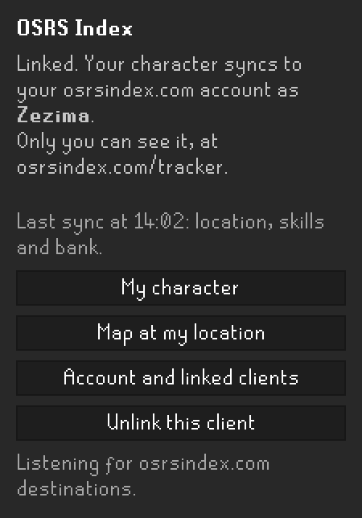
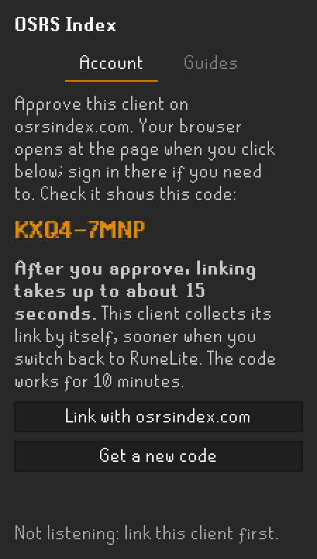
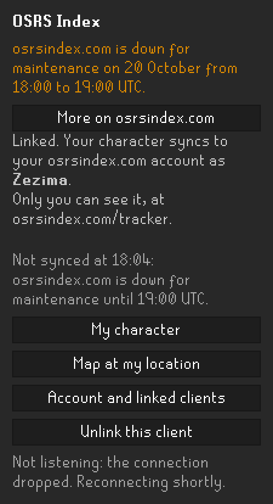
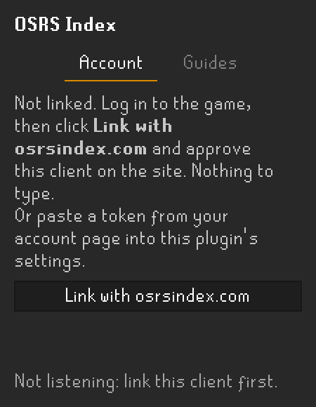
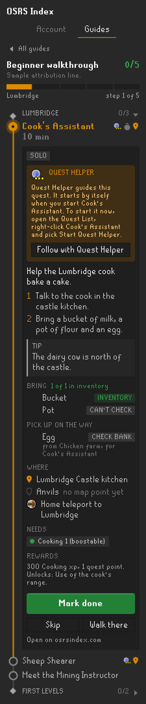
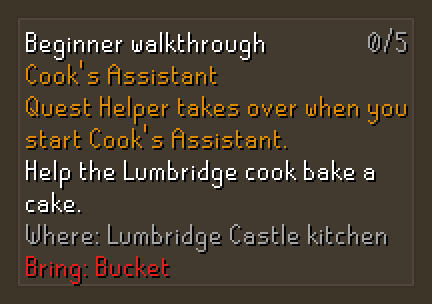
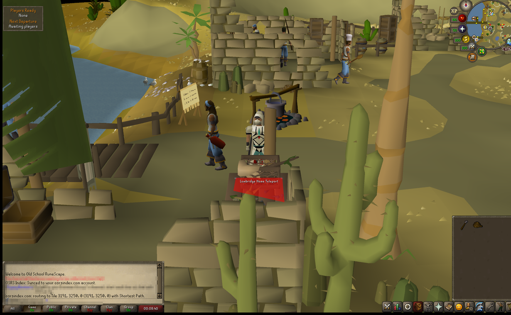
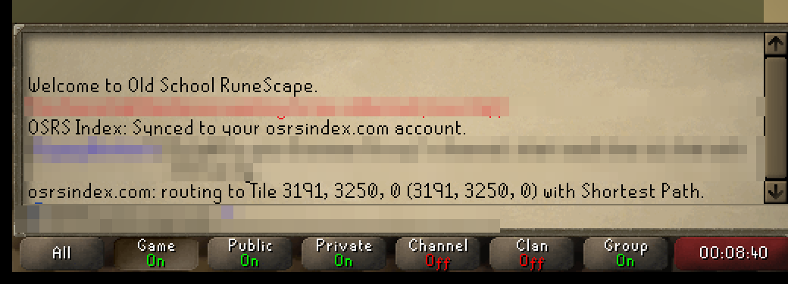

# OSRS Index

A RuneLite plugin that syncs your character to your own [osrsindex.com](https://osrsindex.com) account, and brings
the site into the game. Only you can see what it sends, on your character page.

**You need a free osrsindex.com account to link it.** Make one at [osrsindex.com/account](https://osrsindex.com/account)
with just your email address: the site emails you a code, and the same code creates the account. An account tracks
up to 10 characters.

<p align="center">
  
</p>

- [Features](#features)
- [Linking](#linking)
- [What it sends](#what-it-sends)
- [Connections it makes](#connections-it-makes)
- [What osrsindex.com can change](#what-osrsindexcom-can-change)
- [Your data](#your-data)
- [The panel](#the-panel)
- [Guides](#guides)
- [Walk here from the site](#walk-here-from-the-site)
- [Settings](#settings)
- [Chat messages](#chat-messages)
- [Building from source](#building-from-source)

## Features

- **One-click linking:** no token to paste and no code to type.
- **Character sync:** gear, bank and item stores, skills, quests, diaries, combat achievements, collection log, slayer,
  kill counts, Grand Exchange offers and location.
- **Guides:** follow osrsindex.com's step-by-step guides in the panel, as Quest Helper shows a quest, with quest
  steps handed to Quest Helper. No link needed.
- **Walk here from the site:** pick a place on osrsindex.com's map, and this client routes you there with Shortest
  Path.
- **A panel** with your last sync and buttons to your character page, the map at your location and your account.

## Linking



**Until you click Link, the plugin sends nothing about your character.** An unlinked client makes no request to
osrsindex.com, apart from downloading the [guides](#guides) you open in the Guides tab, which carries nothing about
you. Once per session it says in chat that it is not linked.

1. Log in to the game, open the **OSRS Index** sidebar panel (the orange roundel), and click **Link with
   osrsindex.com**.
2. Your browser opens at osrsindex.com with this client's code already filled in. Sign in, or make an account, if
   you are not already signed in.
   Check that the page names your character and shows the same code as the panel, then click **Approve**.
3. Switch back to RuneLite. **The first link takes up to about 15 seconds after you approve.** Chat then says
   "Linked to your osrsindex.com account.", and syncing starts.

A code works for 10 minutes, and **Get a new code** in the panel makes a new one. You can also type the code at
osrsindex.com/link, or paste a token from your account page into **Account token** in the plugin's settings.

**Unlink this client** in the panel stops all sending. It also revokes this client's link on osrsindex.com, so the
link stops working anywhere and no longer counts toward your account's 5 linked clients. The client is unlinked at
once, even offline. Chat then says whether osrsindex.com confirmed the revoke. If it did not, revoke the client on your
account page.

<br clear="right" />

## What it sends

Only while linked, and only what changed. Each group can be turned off in the plugin's [settings](#settings).

| What | Exactly | When |
|---|---|---|
| Worn items and inventory | item ID and quantity per slot | when they change |
| Bank | item ID and quantity, up to 2,000 items | when it changes while open (the client can read it only then) |
| Account type and combat level | normal, ironman and so on; combat level | at login, and when they change |
| Skills | level and xp per skill | at login, and on xp changes |
| Quests | every quest's state, and quest points | at login, and when quest points change |
| Achievement diaries | which tiers of each region are complete | at login, and when one completes |
| Combat achievements | tasks completed per tier | at login, and when one completes |
| Collection log | obtained/total, plus item ID and quantity for the items on each log page you open | at login, and as you browse the log |
| Location | x, y, plane and world. The site keeps the latest point only | when you move |
| Progress values | the game's own counters for combat achievement tasks, diary tasks, slayer, quest steps, music, clues, minigames, pets, fairy rings and prayers; your current Slayer assignment's name, area and remaining count | when any changes |
| Item stores | item ID and quantity in the looting bag, seed vault, GIM group storage, quiver, POH costume room, forestry kit and huntsman's kit | when one is opened or checked |
| Kill counts | the boss name and count from "Your X kill count is: N." chat lines | as they appear |
| Grand Exchange offers | per slot: item ID, price, quantity, amount traded, coins spent, and state | when an offer changes |

**Every sync also carries:**
- your character name, so the site files the data under the right character;
- when the data was read;
- this client's link token, which identifies your account.

**Never sent:**
- your password or login details;
- chat messages: the plugin reads kill count lines inside the client and sends only the boss and the count;
- other players' data: another player's Adventure Log is skipped;
- anything from Leagues, Deadman, beta, speedrunning, tournament, Fresh Start, PvP Arena or Last Man Standing worlds,
  whose progress is not your account's own: on those worlds the plugin reads and sends nothing;
- values for the player-owned house, interface settings and options, or account details such as bank PIN state.

The plugin sends at most one sync every 30 seconds. Nothing is lost if a sync fails: a change stays queued until the
site confirms it was stored.

**The collection log fills in as you browse.** RuneLite can read a collection log item only while its page is on
screen. The obtained/total count is always right, because it comes from the game's own counter. The item list grows
as you open pages, and it is kept in your RuneLite profile. To fill it at once, open the log and click through each
tab.

## Connections it makes

Every connection goes to osrsindex.com, or to its relay, and only over HTTPS. The plugin talks to no other server,
and has no analytics or tracking.

| Connection | When | Sends | Receives |
|---|---|---|---|
| `POST osrsindex.com/api/v1/tracker/link/start` | only when you click **Link with osrsindex.com** | your character name, shown on the approval page | a link code |
| `POST osrsindex.com/api/v1/tracker/link/poll` | while that code waits: every 15 seconds, for up to 10 minutes | the code | the link token, once you approve |
| `POST osrsindex.com/api/v1/tracker/sync` | linked and logged in: at most once every 30 seconds, when something changed | the data in [What it sends](#what-it-sends) | which parts were stored |
| `GET osrsindex.com/api/v1/tracker/plugin-config` | linked and logged in: at login, then about once an hour | nothing but the link token | sync settings and an optional notice ([what the site can change](#what-osrsindexcom-can-change)) |
| `DELETE osrsindex.com/api/v1/tracker/token` | when you click **Unlink this client** | the link token, so the site revokes it | nothing |
| `wss://relay.osrsindex.com/v1/destinations` | linked, logged in, and **Receive destinations** on: one connection kept open | the link token when it connects; an acknowledgement for each place it receives (its id and what became of it: routed, Shortest Path off, expired, or unreadable) | the places you send from the site's map, and nothing else |
| `GET osrsindex.com/api/v1/guides` | only when you open the Guides tab: at most once an hour, linked or not | nothing: no token, no character data | the list of guides the site offers in RuneLite |
| `GET osrsindex.com/api/v1/guides/<id>` | when you open a guide, and again only once the site changed it, linked or not | nothing: no token, no character data | that guide's sections and steps |

**Every request:**
- carries the plugin's version number in an `X-OSRS-Index-Plugin` header, so your account page can show which
  version each linked client runs;
- shows your IP address to osrsindex.com, as any web request does.

**Inside RuneLite only, nothing leaves the client:**
- A place from the site's map, or a guide step's place when you click **Walk there**, is handed to the Shortest Path
  plugin through RuneLite's plugin messages.
- **Follow with Quest Helper** on a guide's quest step posts a `questhelper` `start` message with the quest's name.
  The plugin reads Quest Helper's place in the plugin list and its "Auto start helper" setting, and never changes
  Quest Helper's settings.
- The plugin greets the author's other plugins (Farm Route Planner, Slayer Route Planner) the same way, so they know
  it is there.

**Your browser, not the plugin:** the panel's buttons open osrsindex.com pages.

## What osrsindex.com can change



While this client is linked and you are logged in, it asks osrsindex.com about once an hour for its sync settings.
That lets the site adjust the plugin without you installing an update:
- **Pause a group** it cannot take right now, such as the bank. It can never turn on a group you turned off.
- **Choose the progress values** sent, for example to add a new quest's progress. It can only pick from the
  plugin's own list, or add values newer than this release that are named as progress. Leagues, POH, interface
  settings and account details are never sent, whatever it asks.
- **Tune the waits**, such as how long to wait after a busy site, within limits the plugin sets. None can make the
  plugin send more often than it does on its own.
- **Pause Walk here** for a while.
- **Show a notice** at the top of the panel, and once in chat if it matters, for example about maintenance. A
  button opens more on osrsindex.com, never another site.
- **Explain a refusal:** when the site cannot store a sync, it can say why in its own words, and the panel and chat
  show that.

Settings from the site are only ever data: it cannot make the plugin run anything, or send anything outside
[What it sends](#what-it-sends). Without them, or if the site cannot be reached, the plugin works as described here.

<br clear="right" />

## Your data

The plugin's wiki has the full picture: [Security and your data](https://github.com/modhollow/osrs-index-plugin/wiki/Security-and-your-data)
says what leaves your computer, how your link token is kept, what osrsindex.com can and cannot change, and what the
plugin never does. [Connections it makes](https://github.com/modhollow/osrs-index-plugin/wiki/Connections-it-makes)
lists every request.

- **Who sees it:** only you, signed in at osrsindex.com.
- **Delete it:** **Delete tracker data** on your [account page](https://osrsindex.com/account#runelite) removes
  everything the plugin has sent.
- **Stop it:** turn a group off in the settings and it stops being sent. **Unlink this client** stops everything,
  and revokes the link on the site.
- **Kept on your computer:** your link token, and the collection log items, item stores and kill counts the plugin
  has read. They stay in your RuneLite profile, so they are not lost between sessions. Your guide progress is kept
  there too, per character, and is never sent.

## The panel



The panel has two tabs: **Account**, described here, and [**Guides**](#guides). Before linking, the Account tab
shows how to link. Once linked, it shows:
- the character it syncs;
- the last sync, for example "Last sync at 14:02: location, skills and bank.". If a group is ever too large for the
  site to accept, this line names it instead, and that group is sent again when it next changes;
- whether it is listening for places sent from the site.

| Button | Opens |
|---|---|
| **My character** | the page of the character you are logged in as, with everything the plugin has sent |
| **Map at my location** | the site's map at your current tile |
| **Account and linked clients** | your account page: each linked client with Revoke, and Delete tracker data |

<br clear="right" />

## Guides



The **Guides** tab shows osrsindex.com's step-by-step guides inside RuneLite, the way Quest Helper shows a quest.

- **Pick a guide** from the list the site offers. Its count sits over a strip with one segment per step, and every
  step sits on a route line: a green tick when done, a lit orange node at your current step, a ring still to do, a
  dash when skipped. Badges at the end of a row mark a quest step, the items it needs, and a map point.
- **The current step** opens as a card beside the line: its text, how to do it, a tip, what an Ironman does instead,
  where to go, and its rewards. Each item to bring is one short line with its game sprite and a tag saying where it
  is: INVENTORY, BANK or DON'T HAVE. Items to pick up on the way carry the same tags and say where from.
  Requirements are checked against your skills, quests, quest points and account type: green met, red not yet. A
  large **Mark done** button finishes it, and any other step opens the same way with a click.
- **An account that is not new starts where it is.** The plugin reads your quests, levels and bank, and your place is
  the first section of the guide you have not mostly finished: earlier steps the game cannot check count as done,
  earlier ones it shows are not done are flagged as behind you, and a quest done early, far ahead, does not move it.
  **Start here** sets your place by hand.
- **Mark done**, **Skip** and **Reopen** mark a step. A step the site says is complete once you reach a level or
  finish a quest ticks itself, and so does a step to talk to someone, kill something, reach a place or get items,
  once your client sees it happen; the guide then moves on. The count, such as "5/43", leaves skipped steps out, as
  the site does.
- **On the game screen,** as Quest Helper does: a box with the current step, where it is and what you still need to
  bring, the step's tile outlined once it is in view, a minimap arrow toward it, and a world map point. **Walk
  there** routes you with Shortest Path.
- **Quest steps go to Quest Helper** when it is on. Before the quest starts, the step leads you to its start and
  says how Quest Helper starts: by itself when you start the quest (its "Auto start helper" setting), or from the
  Quest List with a right-click on the quest and **Start Quest Helper**. Once the quest is under way, this plugin's
  box, tile, map point and arrow step aside, and the guide moves on when the quest is finished. Quest Helper cannot yet be
  started by another plugin, so **Follow with Quest Helper** puts the manual way in chat.
- **Your progress stays on your computer,** in your RuneLite profile, per character. Nothing about it is sent.
- **Downloads only when you open it.** The list is fetched when you open the tab, at most once an hour, and a guide
  when you open it. Guides are public, so this works without linking, and the requests carry no token and nothing
  about your character.

<p align="center">
  
</p>

<br clear="right" />

## Walk here from the site

Pick a place on osrsindex.com's map and click **Walk here in RuneLite**. This client hands it to the
[Shortest Path](https://runelite.net/plugin-hub/show/shortest-path) plugin, which draws the route. Install and turn
on Shortest Path from the Plugin Hub.

<p align="center">
  
</p>

- **On by default.** A connection to osrsindex.com stays open while this client is linked and you are logged in.
  Turn off **Receive destinations** under *Walk here from the site* in the settings to close it.
- It receives only the places you send, and nothing else.
- If this client gets a place but cannot route it, for example because Shortest Path is off, the site's map says why.
- If another RuneLite client with the same link connects, that client takes over.
- The last line of the panel says whether it is listening.

## Settings

| Setting | Default | What it covers |
|---|---|---|
| **Account token** | empty | Filled in when you link. While it is empty, nothing is sent but the link request you start with **Link with osrsindex.com**. |
| *What to sync:* **Worn items and inventory** | on | Worn items and inventory. |
| *What to sync:* **Bank** | on | The bank, the item stores, and Grand Exchange offers. |
| *What to sync:* **Skills, quests and diaries** | on | Account type and combat level, skills, quests, diaries, combat achievements, kill counts, and the progress values. |
| *What to sync:* **Collection log** | on | The collection log. |
| *What to sync:* **Location** | on | Your position and world. |
| *Walk here from the site:* **Receive destinations** | on | The relay connection that receives places from the site's map. |
| *Guides:* **Show guides** | on | The Guides tab. Off, nothing is downloaded for guides, and there is no map point or arrow. |
| *Guides:* **World map marker** | on | The current step's point on the world map. |
| *Guides:* **Minimap arrow** | on | The arrow on the minimap toward the current step's place. |
| *Guides:* **Tile highlight** | on | The outline on the current step's tile in the game world. |
| *Guides:* **Step box** | on | The box with the current step on the game screen. |
| *Guides:* **Hand quest steps to Quest Helper** | on | Let Quest Helper guide a guide's quest steps while it is on. |

## Chat messages

Every line starts with "OSRS Index:", except the two that start "osrsindex.com".

<p align="center">
  
</p>

| Message | Meaning |
|---|---|
| This client is not linked to osrsindex.com, so nothing is sent… | Shown once per session while unlinked. Click **Link with osrsindex.com** in the panel to link. |
| Approve this client in your browser… | You clicked Link. Approve on the page that opened; linking takes up to about 15 seconds after that. |
| Linked to your osrsindex.com account. | The link was approved, and syncing starts. |
| Synced to your osrsindex.com account. | The first sync of the session was stored. |
| osrsindex.com did not accept this client's link… | The link was revoked. Link again from the panel. |
| The site refused part of a sync (code). | The site could not store part of a sync. It is sent again when that data changes. |
| A message from osrsindex.com | The site explained why it did not store a sync, or posted a notice. The panel shows it too. |
| Your osrsindex.com account already tracks the most characters it can… | The account is full, so this character was not synced. Delete tracker data on your account page to make room; the plugin tries again every 15 minutes. |
| osrsindex.com: routing to PLACE (x, y, plane) with Shortest Path. | A place you sent from the site's map is being routed. |
| osrsindex.com sent PLACE (x, y, plane), but Shortest Path is not on. | Install or turn on Shortest Path, then send the place again. |
| Routing to PLACE (x, y, plane) with Shortest Path. | You clicked **Walk there** on a guide step. |
| Shortest Path is not on, so the way to PLACE (x, y, plane) cannot be drawn… | **Walk there** needs Shortest Path. Install or turn it on, then click again. |
| Asked Quest Helper to show QUEST. If it does not, open the Quest List… | You clicked **Follow with Quest Helper**. Start it from the Quest List if it did not open. |

## Building from source

You need JDK 17. The plugin compiles to Java 11 bytecode, as the Plugin Hub requires.

```
./gradlew build
```

```
./gradlew run
```

`gradlew run` opens RuneLite in developer mode with the plugin loaded, in its own `osrs-index-dev` profile, so your
normal settings are untouched. `gradlew panelImages` redraws the panel images in `images/`.

## License

BSD 2-Clause. See [LICENSE](LICENSE).
